<div align="center">

# Topology Optimization in Python

**A 2D SIMP topology optimizer written from scratch: finite elements, filtering, optimality-criteria updates, and export to a printable STL.**

[](https://www.python.org/)
[](#running-the-tests)
[](#how-it-works)
[](#6-launch-the-web-app)
[](LICENSE)

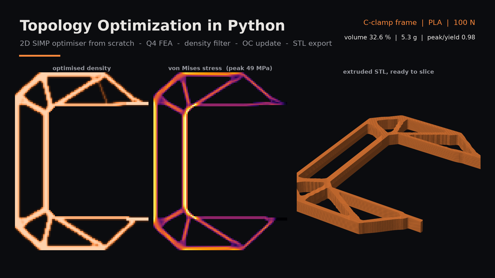

</div>

## Why this project

At Northeastern I designed and built a **topology-optimized C-clamp**. I ran the optimization in ANSYS under a 100 N load and cut part volume to **32.6 %** while keeping peak stress within PLA limits. The part was printed by FFF at **under 6 g** with **±0.2 mm** accuracy, then tested to destruction at **0.63 kN**.

ANSYS gives the answer but hides how it gets there. This repository is the method written out in under 1,000 lines of readable Python: the finite-element solver, SIMP penalization, the density filter, and the optimality-criteria update. It runs the classic academic benchmarks and a C-clamp load case based on my project. The last step turns the optimized density field into a **watertight STL you can send to a slicer**.

| | |
|---|---|
| **FEA** | Bilinear Q4 plane-stress elements, sparse assembly (`scipy.sparse`), direct solve. Checked against Euler-Bernoulli/Timoshenko beam theory to within 1 %. |
| **Optimization** | Modified SIMP (`E = Emin + x^p (E0 - Emin)`), OC update with bisection on the volume multiplier, move limits, passive solid/void regions. |
| **Regularization** | Density filter (default), sensitivity filter, or density filter + Heaviside projection with β-continuation. |
| **Outputs** | Convergence plots, density images, animated GIF, von Mises stress field, CSV history, JSON summary, **extruded STL** (marching squares, then polygons, then extrusion). |
| **Interfaces** | CLI (`python -m topopt run ...`), Streamlit web app, plain Python API. |
| **Verification** | 29 pytest tests: element matrix vs. the published 88-line code, rigid-body modes, patch test, beam theory, volume constraint, monotone compliance, MBB benchmark range, STL watertightness. |

---

## Results

<div align="center">
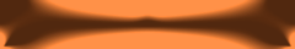<br>
<sub>MBB beam, 120x40 elements, volume fraction 0.5: the design taking shape over 263 OC iterations (mirrored about the symmetry plane).</sub>
</div>

### Final designs

| MBB beam (120x40, V = 0.5) | Cantilever (80x40, V = 0.4) |
|---|---|
| 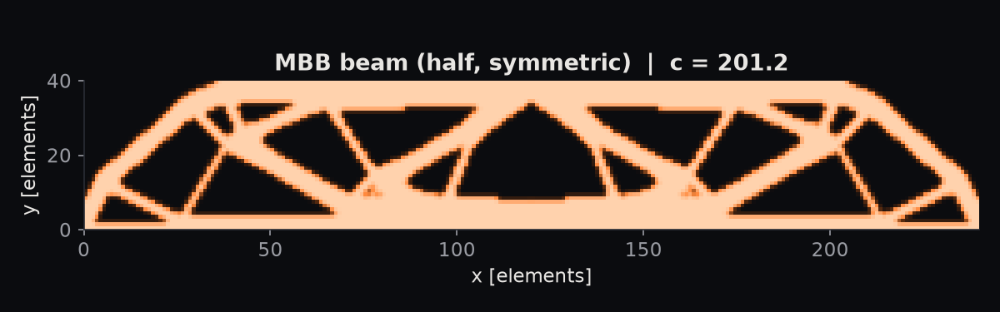 | 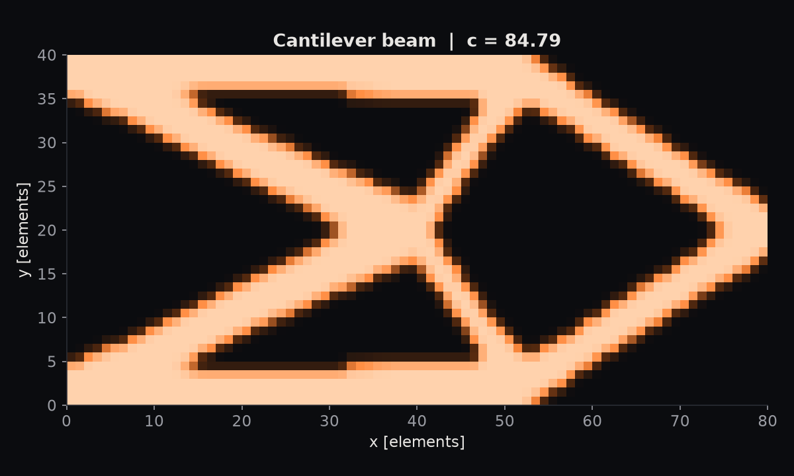 |
| **L-bracket (100x100, V = 0.4, passive void)** | **MBB + Heaviside projection (crisp 0/1)** |
| 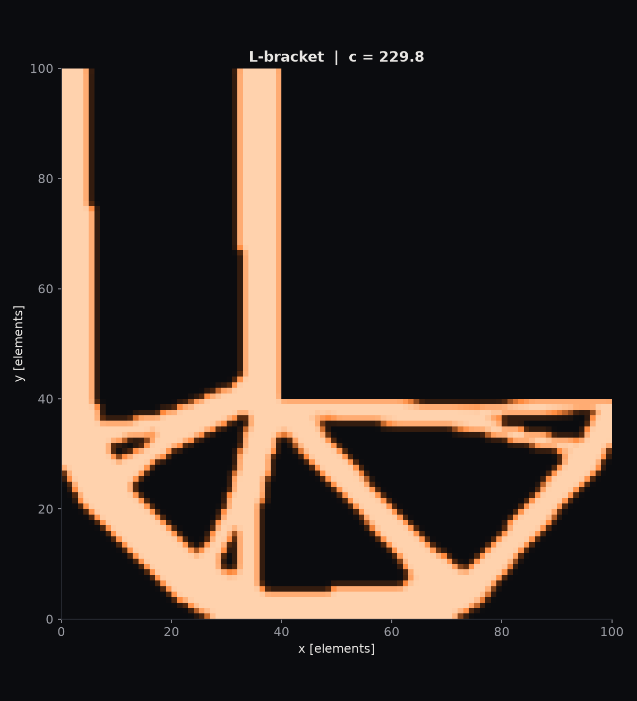 | 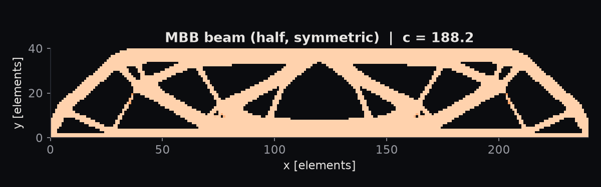 |

### Stress fields of the final designs

| MBB beam | L-bracket |
|---|---|
| 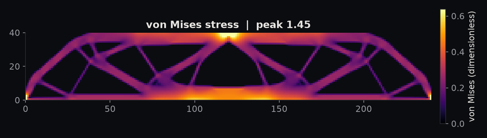 | 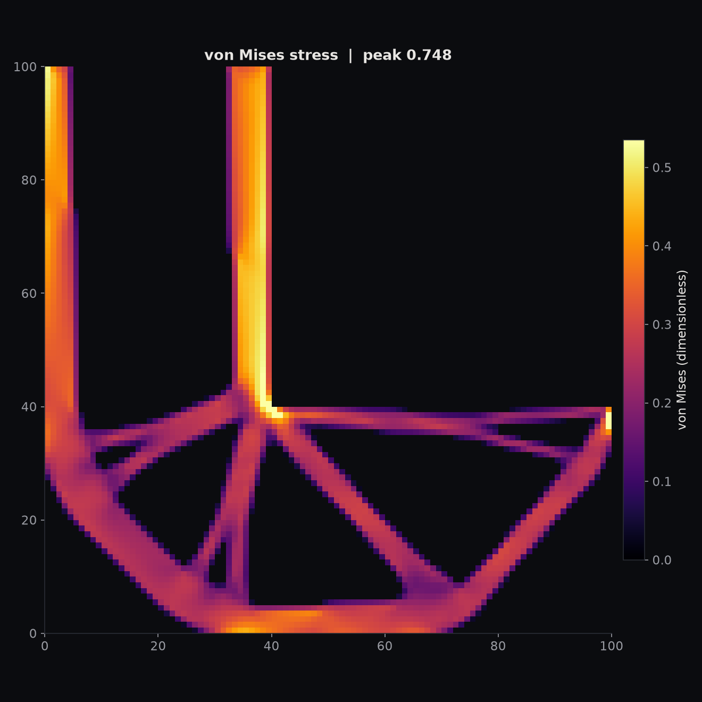 |
| **Cantilever** | **C-clamp (MPa)** |
| 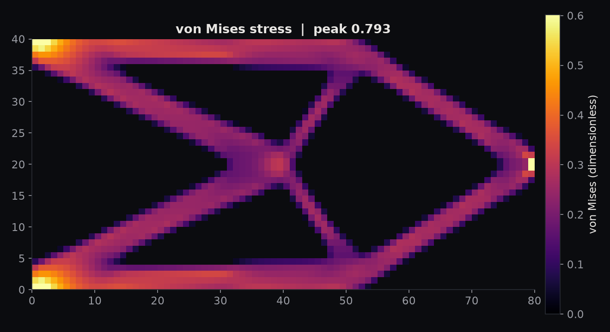 | 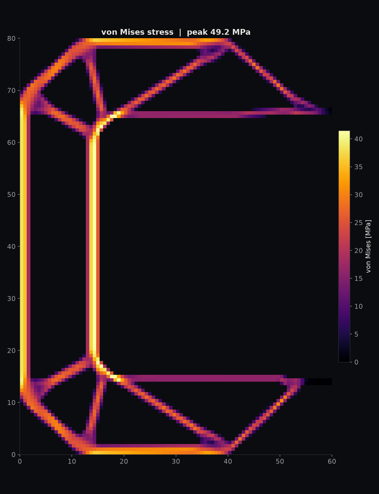 |

### Convergence

| MBB beam | C-clamp |
|---|---|
| 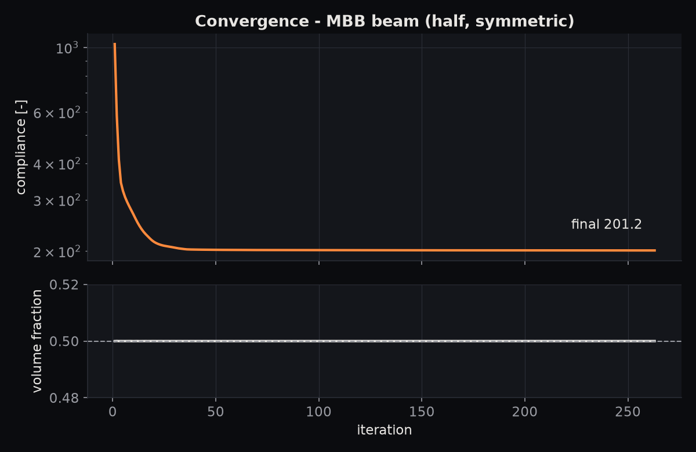 | 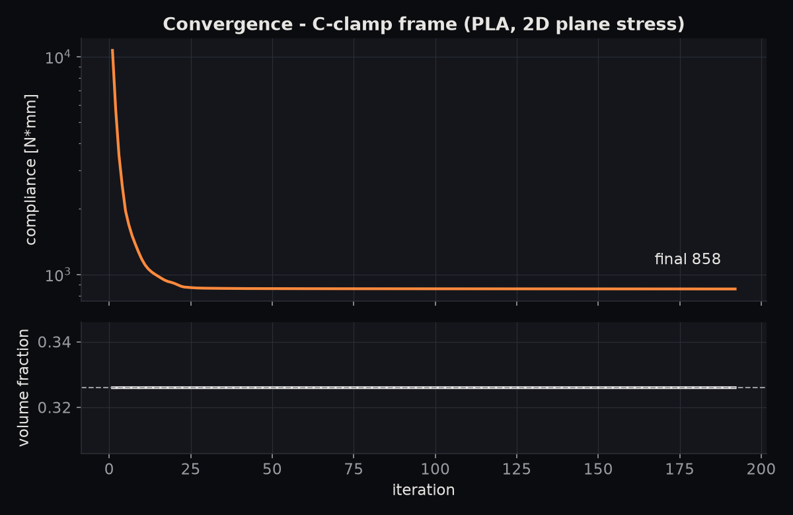 |

Compliance falls by about an order of magnitude in the first 20 to 30 iterations, then the OC loop spends its remaining iterations sharpening member boundaries. The volume constraint stays active (exactly on target) the whole time.

### Results table

Every number below comes from `python scripts/generate_docs.py`, run on a Windows 11 laptop (Python 3.12, SciPy SuperLU). Settings for all runs: penal = 3, rmin = 1.5, move = 0.2, stop when max |Δx| < 0.01.

| Run | Case | Mesh | Filter | volfrac | Final compliance | Iterations | Converged | Runtime [s] |
|---|---|---|---|---|---|---|---|---|
| `mbb_60x20_sens` | MBB | 60x20 | sensitivity | 0.5 | 203.2 | 94 | yes | 0.6 |
| `mbb_60x20_dens` | MBB | 60x20 | density | 0.5 | 218.8 | 126 | yes | 0.8 |
| `mbb` | MBB | 120x40 | density | 0.5 | 201.2 | 263 | yes | 8.4 |
| `mbb_heaviside` | MBB | 120x40 | Heaviside | 0.5 | 188.2 | 400 | no (max it.) | 13.6 |
| `cantilever` | cantilever | 80x40 | density | 0.4 | 84.79 | 212 | yes | 5.2 |
| `lbracket` | L-bracket | 100x100 | density | 0.4 | 229.8 | 228 | yes | 22.4 |
| `cclamp` | C-clamp | 90x120 | density | 0.326 | 858 N·mm | 192 | yes | 18.6 |

The benchmark cases use dimensionless units (E0 = 1, ν = 0.3, unit load), so their compliances can be compared with the literature. The element stiffness matrix matches the closed-form matrix of the 88-line MATLAB code to machine precision (tested), and the MBB boundary conditions and OC update are the same as in that code. The 60x20 runs therefore reproduce the textbook setup. Runtimes vary by a factor of about 2 depending on machine load.

---

## The C-clamp case: a link back to my ANSYS project

<div align="center">
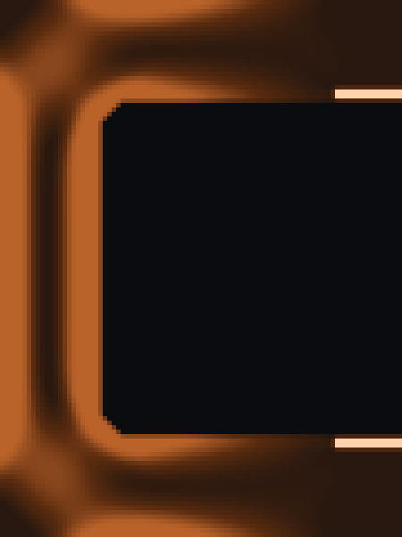
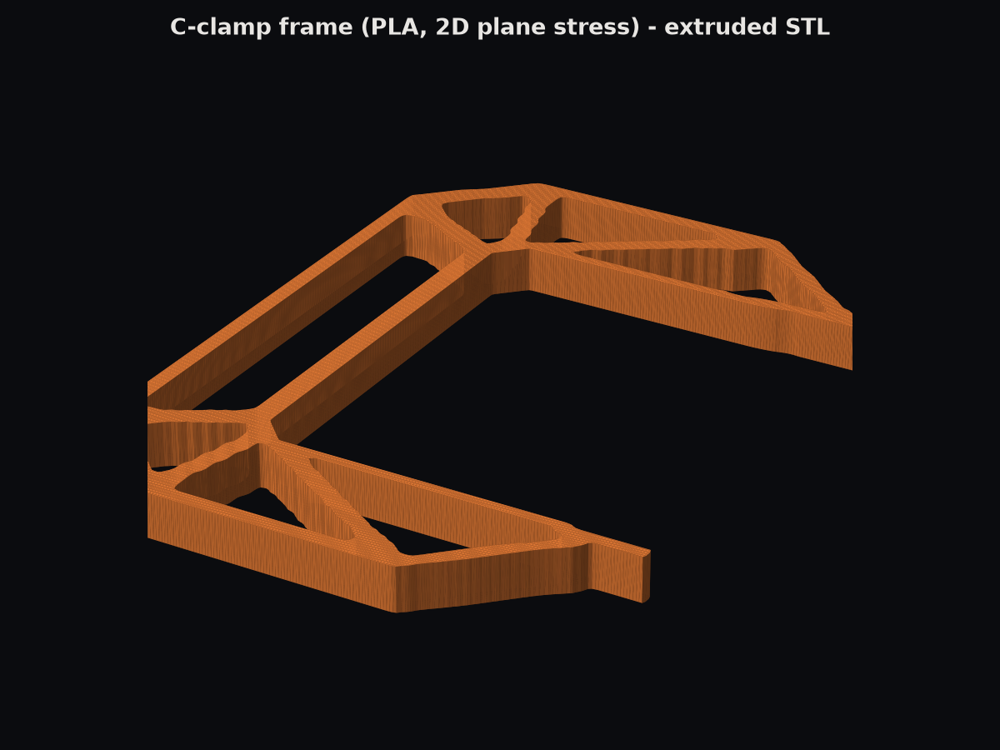
</div>

`python -m topopt run --case cclamp` sets up a **2D plane-stress analogue** of my printed C-clamp:

* **Design domain:** a 60 x 80 mm C-shaped frame, 5 mm thick. The throat of the C is a passive void with 6 mm fillets at its inner corners (a sharp re-entrant corner would cause an artificial stress singularity).
* **Loading:** the workpiece pushes the jaws apart with **100 N**. The anvil face of the lower jaw is supported vertically, and the 100 N acts upward on the screw-boss face of the upper jaw. The load is self-equilibrated through the frame, so this is equivalent to a free-floating clamp. Thin passive solid pads sit under both contact faces.
* **Material:** PLA, E = 3.5 GPa, ν = 0.36, yield about 50 MPa, density 1.24 g/cm³.
* **Target:** volume fraction **0.326**, the 32.6 % of my ANSYS study.

**Result:** 192 iterations, compliance 858 N·mm, final volume 32.6 %. The extruded part has a mass of **5.3 g** (under 6 g, like the printed part). Peak element von Mises stress is **49 MPa**, about 0.98 of yield, located at the filleted throat corners. The optimizer converges to the shape a mechanical engineer would expect: two flanges carry the bending moment in the spine, like an I-beam, and triangulated trusses carry the load out to each jaw.

> **Honest limitations.** This is a 2D plane-stress approximation of a 3D ANSYS study, not a re-creation of it. Thickness is uniform, the geometry and support conditions are idealized, there is no screw or contact model, and the material is linear-elastic and isotropic (real FFF parts are anisotropic and have layer-adhesion weak planes). Compliance minimization does not limit stress directly; stress is checked afterwards. The peak value is an element-centre value on a 0.67 mm mesh, and a linear extrapolation of it (about 100 N at first yield) should **not** be compared with the 0.63 kN destructive test of the real 3D part, which had a different cross-section and failed after plastic deformation. The purpose of this case is to show the method on a familiar problem, not to replace the original analysis.

---

## How it works

```mermaid
flowchart LR
    A([Initial design<br/>x = volfrac everywhere]) --> B[Filter / project<br/>x → x̃ → x_phys]
    B --> C[FEA<br/>K&#40;x_phys&#41; u = F]
    C --> D[Objective & sensitivities<br/>c = Fᵀu,  ∂c/∂x_e]
    D --> E[Chain rule through filter<br/>∂c/∂x,  ∂V/∂x]
    E --> F[OC update<br/>bisection on λ, move limits,<br/>passive regions]
    F --> G{max Δx < tol ?}
    G -- no --> B
    G -- yes --> H([Final design<br/>stress, GIF, STL])
    style A fill:#14161b,stroke:#ff8a3d,color:#e8e6e3
    style B fill:#14161b,stroke:#ff8a3d,color:#e8e6e3
    style C fill:#14161b,stroke:#ff8a3d,color:#e8e6e3
    style D fill:#14161b,stroke:#ff8a3d,color:#e8e6e3
    style E fill:#14161b,stroke:#ff8a3d,color:#e8e6e3
    style F fill:#14161b,stroke:#ff8a3d,color:#e8e6e3
    style G fill:#0b0c0f,stroke:#ff8a3d,color:#ff8a3d
    style H fill:#ff8a3d,stroke:#ff8a3d,color:#0b0c0f
```

**1. Finite-element analysis.** The design domain is split into `nelx x nely` square, bilinear 4-node (Q4) elements. Each element's 8x8 stiffness matrix is integrated exactly with 2x2 Gauss quadrature:

$$K_e = \int_{\Omega_e} B^T D\, B \, t\, d\Omega, \qquad D = \frac{E}{1-\nu^2}\begin{bmatrix}1&\nu&0\\ \nu&1&0\\ 0&0&\tfrac{1-\nu}{2}\end{bmatrix}$$

The element matrices are scattered into one sparse global matrix (COO triplets, converted to CSC), the supported degrees of freedom are removed, and `K u = F` is solved directly.

**2. SIMP: material interpolation.** Every element gets a density `x_e` between 0 (void) and 1 (solid). Stiffness is interpolated as

$$E_e(x_e) = E_{min} + x_e^{\,p}\,(E_0 - E_{min}), \qquad p = 3$$

With p > 1, intermediate densities give little stiffness for the material they use, so the optimizer is pushed towards a black-and-white design. `Emin = 1e-9 E0` keeps the stiffness matrix non-singular.

**3. Objective and sensitivities.** We minimize compliance, the work done by the loads, which is the inverse of stiffness: `c = Fᵀu = Σ E_e(x_e) u_eᵀ k_0 u_e`. The adjoint method shows that this problem is self-adjoint, so the gradient comes free with the displacement field:

$$\frac{\partial c}{\partial x_e} = -p\,x_e^{\,p-1}(E_0-E_{min})\,u_e^T k_0\, u_e$$

**4. Filtering.** Raw SIMP produces checkerboards and designs that change with the mesh. The **density filter** replaces each density with a weighted average of its neighbours within radius `rmin`, using weights `H_ei = max(0, rmin - dist(e,i))`:

$$\tilde{x}_e = \frac{\sum_i H_{ei}\,x_i}{\sum_i H_{ei}}$$

This sets a minimum member size. Sensitivities are passed back through the same filter by the chain rule. Two alternatives are available: the classic **sensitivity filter** (Sigmund 1997), and **Heaviside projection**, which pushes the filtered field towards a crisp 0/1 design with β doubled every 50 iterations up to 32.

**5. Optimality-criteria (OC) update.** At the optimum, the marginal stiffness gained per unit of added volume is the same in every element. OC applies this condition as a fixed-point update:

$$x_e^{new} = \operatorname{clamp}\!\left(x_e\sqrt{\frac{-\partial c/\partial x_e}{\lambda\,\partial V/\partial x_e}},\; x_e \pm m,\; [0,1]\right)$$

The Lagrange multiplier λ is found by bisection so that the volume constraint holds exactly. Passive elements stay fixed at 0 or 1. The loop stops when no density changes by more than 0.01.

**6. Post-processing.** The element-centre von Mises stress of the final design is `σ = (E_e/E_0) D_0 B(0,0) u_e`, and void elements are masked out. For export, the density field is upsampled and contoured at x = 0.5 with a **marching-squares** routine written for this project. Each cell contributes a convex "inside" polygon (used for the top and bottom caps) and contour segments (used for the side walls). Neighbouring cells compute shared crossing points in the same order, so vertices coincide exactly and the extruded mesh is **watertight**. The tests check this edge by edge.

---

## Run it on Windows (step by step)

You need **Python 3.10+** (tested with 3.12) and **Git**. All commands below are for **PowerShell**.

### 1. Clone the repository

```powershell
git clone https://github.com/PiyushBhamare2111/topology-optimization-python.git
cd topology-optimization-python
```

### 2. Create a virtual environment

```powershell
py -3.12 -m venv .venv
# or, if the "py" launcher is not available:
# & "$env:LOCALAPPDATA\Programs\Python\Python312\python.exe" -m venv .venv
```

### 3. Activate it

```powershell
.\.venv\Scripts\Activate.ps1
```

If PowerShell refuses with *"running scripts is disabled on this system"*, allow local scripts for your user once and try again:

```powershell
Set-ExecutionPolicy -Scope CurrentUser -ExecutionPolicy RemoteSigned
```

(In `cmd.exe`, use `.venv\Scripts\activate.bat` instead.) Your prompt should now start with `(.venv)`.

### 4. Install the dependencies

```powershell
python -m pip install --upgrade pip
pip install -r requirements.txt
```

### 5. Run the command-line tool

```powershell
# list the available load cases
python -m topopt list

# classic MBB beam
python -m topopt run --case mbb --nelx 120 --nely 40 --volfrac 0.5

# the textbook 88-line setup with the sensitivity filter
python -m topopt run --case mbb --nelx 60 --nely 20 --volfrac 0.5 --penal 3 --rmin 1.5 --filter sensitivity

# cantilever and L-bracket
python -m topopt run --case cantilever --nelx 80 --nely 40 --volfrac 0.4
python -m topopt run --case lbracket --nelx 100 --volfrac 0.4

# C-clamp (PLA, N/mm/MPa) with crisp black/white Heaviside projection
python -m topopt run --case cclamp --nelx 90 --volfrac 0.326 --filter heaviside --maxiter 300
```

Every run writes its results to `results\<case>\` (change this with `--out`):

| File | Contents |
|---|---|
| `density.png`, `stress.png`, `convergence.png` | final design, von Mises field, compliance and volume vs. iteration |
| `optimization.gif` | animation of the optimization |
| `design.stl`, `stl_render.png` | extruded, watertight STL plus a preview render |
| `history.csv`, `summary.json`, `density.npy` | raw data |

Useful options: `--penal`, `--rmin`, `--filter {density,sensitivity,heaviside}`, `--maxiter`, `--tol`, `--move`, `--thickness` (STL extrusion), `--no-gif`, `--no-stl`, `--quiet`. Run `python -m topopt run --help` to see them all.

### 6. Launch the web app

```powershell
streamlit run app.py
```

Then open **http://localhost:8501** in your browser. Pick a case in the sidebar, adjust the mesh, volume fraction, penalty, filter radius and filter type, and press **Run optimisation**. A live progress bar shows each iteration. When the run finishes, the tabs show the design, convergence, stress and 3D/STL views, and buttons below let you download the STL, GIF, CSV and NPY files. Stop the server with `Ctrl+C`.

| Start screen | Results (C-clamp) |
|---|---|
| 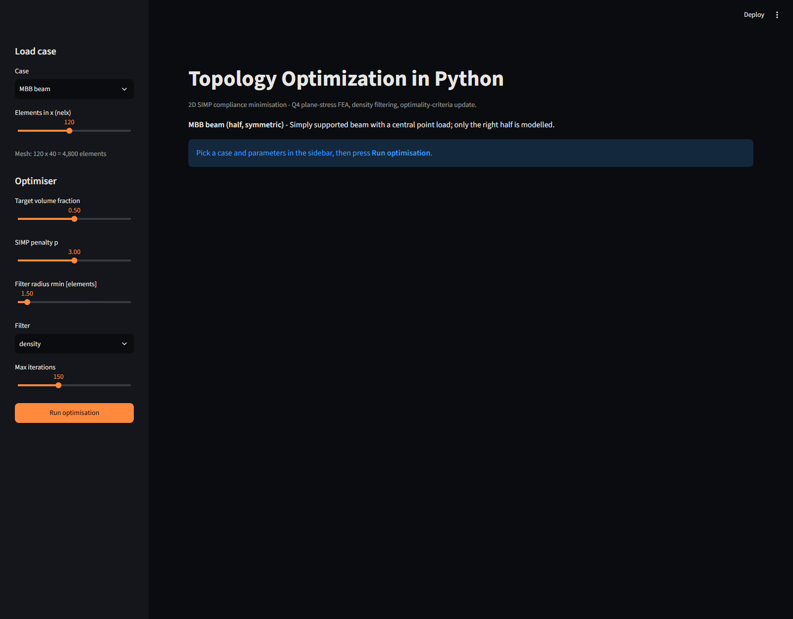 | 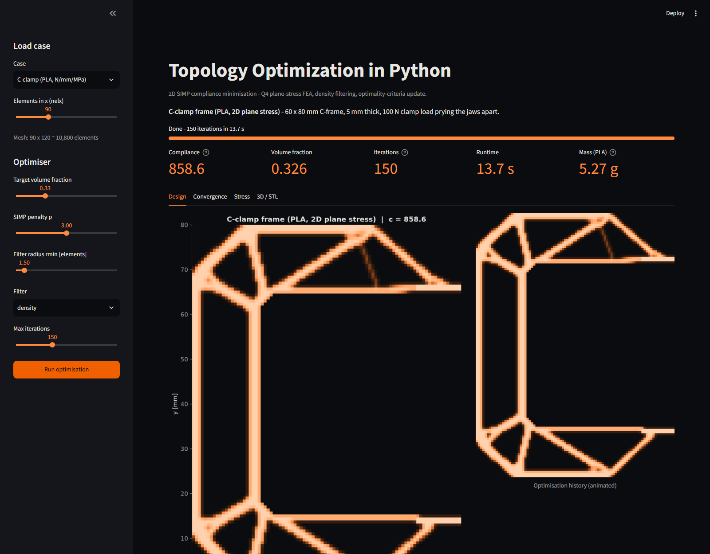 |
| **Stress tab** | **3D / STL tab** |
| 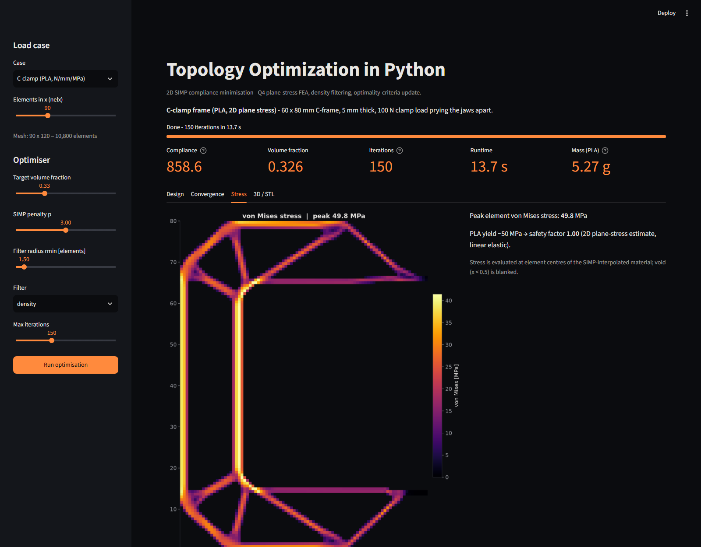 | 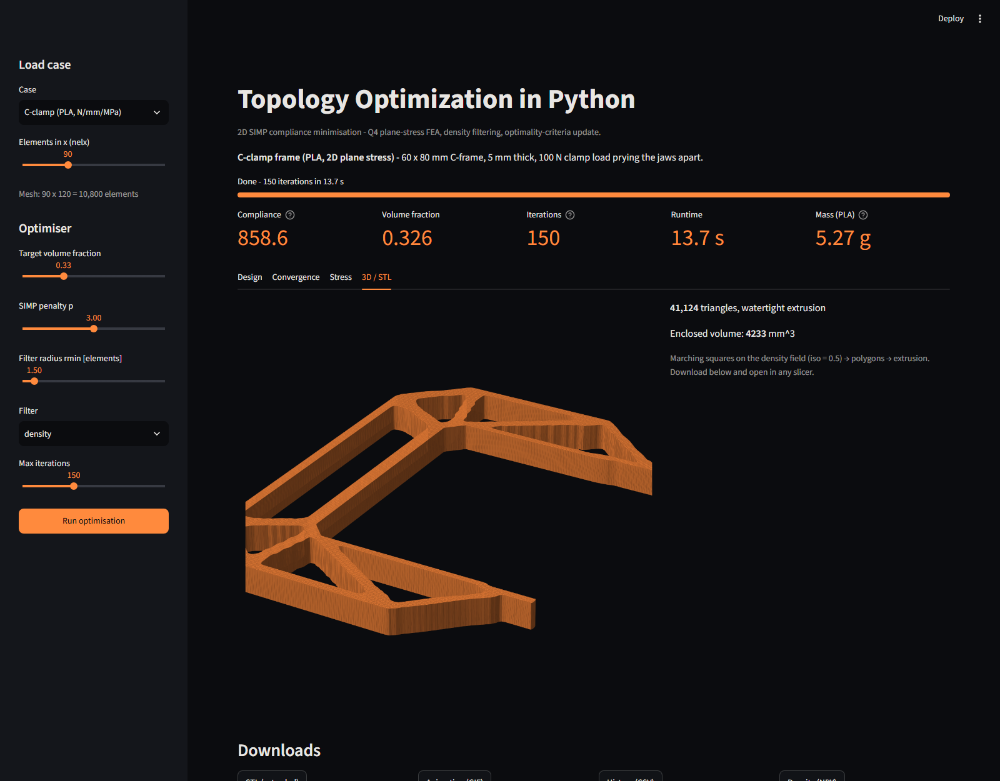 |

### 7. Use it from Python

```python
from topopt import make_case, optimize, Settings
from topopt.export import export_stl
from topopt.visualize import plot_density

problem = make_case("cclamp", nelx=90)
result = optimize(problem, Settings(volfrac=0.326, penal=3, rmin=1.5, filter="density"))
print(result.summary())          # compliance, volume, iterations, mass, peak stress ...
plot_density(result, "clamp.png")
export_stl(result, "clamp.stl")  # 5 mm extrusion in mm, ready for a slicer
```

## Running the tests

```powershell
python -m pytest            # 29 tests, about 15 s
python -m pytest -v         # list each test
```

The tests cover:

* **Element:** `K_e` equals the closed-form 88-line matrix for several values of ν. It is symmetric and positive semi-definite, with exactly **3 zero-energy (rigid-body) modes**. It passes a constant-strain patch test.
* **Solver:** the tip deflection of a fully solid cantilever (100x10 and 200x20 meshes) is within **2 %** of both Euler-Bernoulli and Timoshenko beam theory (the measured error is under 1 %). The von Mises stress of a bar under uniaxial tension is exact.
* **Optimizer:** the volume constraint is met to 1e-3. Compliance decreases monotonically after the first few iterations. The MBB 60x20 benchmark (V = 0.5, p = 3, rmin = 1.5) converges to c = 203 (sensitivity filter) and c = 219 (density filter), and its topology has the expected chords and supports. Heaviside projection yields a crisp design. Passive regions are respected, and the callback can stop a run early.
* **Export and CLI:** the extruded STL is watertight with the correct volume, including holes and saddle cells. The CLI writes every output file.
* **App:** a Streamlit `AppTest` runs a full optimization through the UI and checks that no exceptions occur.

To redo the screenshots, the app is driven in a real headless Chromium. The script starts Streamlit, checks that it answers HTTP 200, runs a C-clamp optimization, saves the screenshots and stops the server:

```powershell
pip install -r requirements-dev.txt
python -m playwright install chromium
python scripts\screenshot_app.py
```

To regenerate all of `docs/` (every case, the results table and the showcase media), run `python scripts\generate_docs.py`. It takes about 1 to 2 minutes.

## Project structure

```
topology-optimization-python/
├── topopt/
│   ├── fem.py          # Q4 plane-stress element, sparse assembly, solve, von Mises
│   ├── filters.py      # density / sensitivity filter, Heaviside projection
│   ├── optimizer.py    # SIMP + OC loop, passive regions, Settings / Result
│   ├── cases.py        # MBB, cantilever, L-bracket, C-clamp load cases
│   ├── export.py       # marching squares -> polygons -> extruded watertight STL
│   ├── visualize.py    # dark-theme plots, GIF, stress field, 3D STL render
│   ├── cli.py          # `python -m topopt run|list`
│   └── __main__.py
├── app.py              # Streamlit app
├── tests/              # pytest suite (FEM, optimizer, export/CLI, app)
├── scripts/
│   ├── generate_docs.py    # reproduces every figure in docs/
│   └── screenshot_app.py   # headless Streamlit + Playwright screenshots
├── docs/               # results per case, media/ (1920x1080 showcase PNGs, frames), screenshots/
├── requirements.txt    # pinned runtime deps
├── requirements-dev.txt
└── LICENSE
```

## Showcase media

High-resolution stills for presentations live in [`docs/media/`](docs/media):
`01_hero_cclamp.png`, `02_benchmark_gallery.png`, `03_mbb_evolution.png` and `04_convergence.png` are 1920x1080; `05_stl_render_square.png` is 1080x1080. Per-iteration 1080x1080 frames of the C-clamp optimization are in `docs/media/frames_cclamp/`, and `cclamp_optimization_540.gif` is a GIF version.

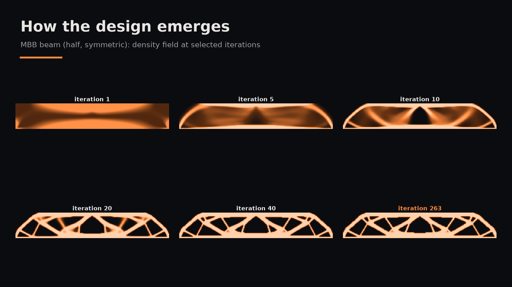

## References

1. O. Sigmund, *A 99 line topology optimization code written in Matlab*, Struct. Multidisc. Optim. 21, 120-127 (2001).
2. E. Andreassen, A. Clausen, M. Schevenels, B. S. Lazarov, O. Sigmund, *Efficient topology optimization in MATLAB using 88 lines of code*, Struct. Multidisc. Optim. 43, 1-16 (2011). This is the main reference for the structure of this code. It is a clean-room NumPy rewrite, not a translation of the MATLAB source.
3. M. P. Bendsøe, O. Sigmund, *Topology Optimization: Theory, Methods and Applications*, Springer (2003).
4. T. E. Bruns, D. A. Tortorelli, *Topology optimization of non-linear elastic structures and compliant mechanisms*, CMAME 190 (2001): density filter.
5. J. K. Guest, J. H. Prévost, T. Belytschko, *Achieving minimum length scale in topology optimization using nodal design variables and projection functions*, IJNME 61 (2004); F. Wang, B. S. Lazarov, O. Sigmund, *On projection methods, convergence and robust formulations in topology optimization*, SMO 43 (2011): Heaviside projection.
6. K. Svanberg, *The method of moving asymptotes*, IJNME 24 (1987). MMA is a common alternative to OC and is **not** implemented here.
7. Inspiration for scope and features (no code copied): [williamhunter/topy](https://github.com/williamhunter/topy) and [calculix/beso](https://github.com/calculix/beso).

## License

[MIT](LICENSE) © 2026 Piyush Bhamare
